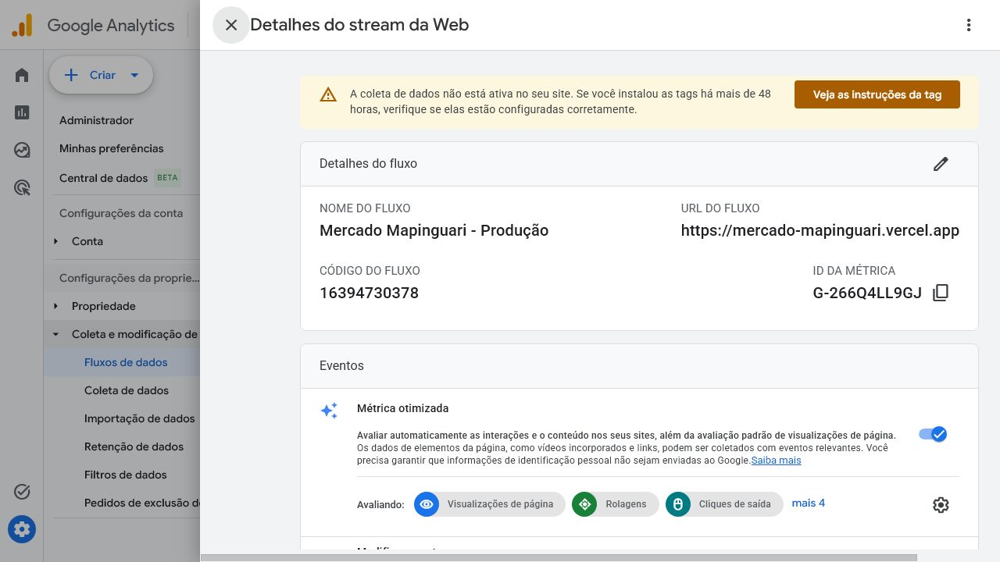
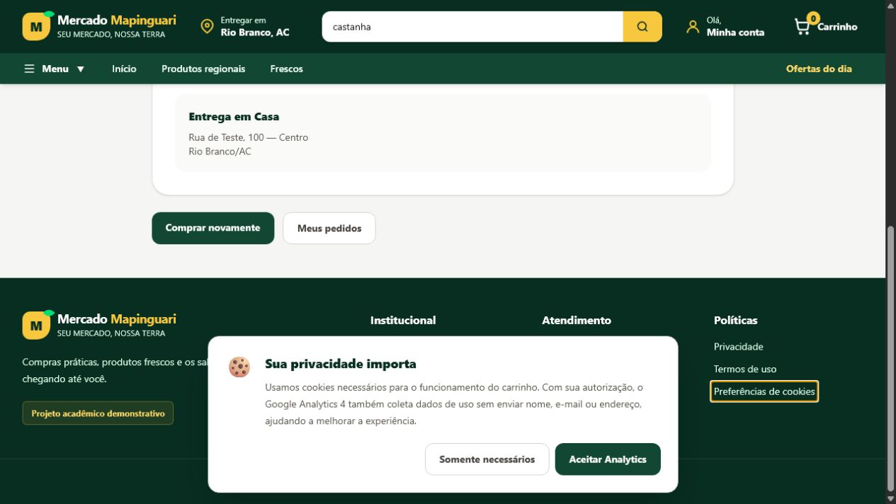
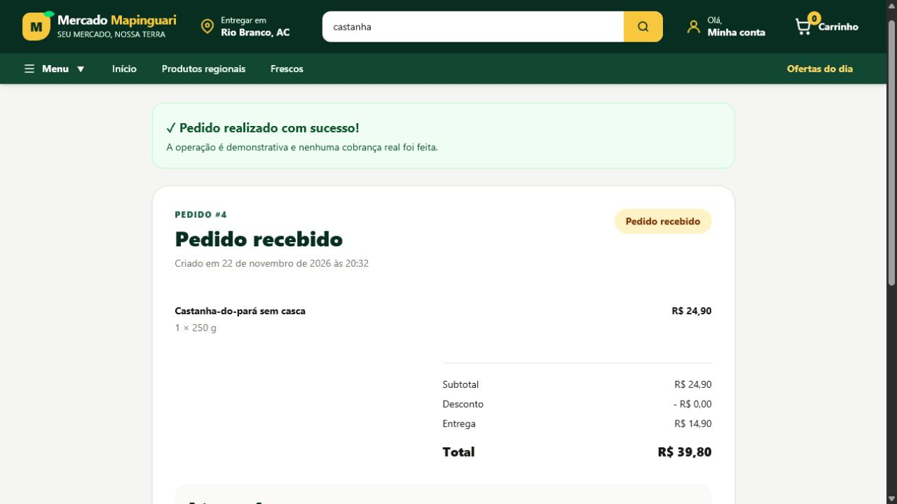

# Mercado Mapinguari
## Relatório de implementação e validação do Google Analytics 4

**Aluno:** Edwiller de Lima  
**Projeto:** Web e Comércio Eletrônico  
**Instituição:** Instituto Federal do Acre — Campus Rio Branco  
**Professor:** Valdenir Junior  
**Data da validação:** 22 de novembro de 2026

---

## 1. Identificação do projeto

O **Mercado Mapinguari** é um supermercado virtual demonstrativo, inspirado na experiência de grandes marketplaces e adaptado ao varejo alimentar de Rio Branco, Acre.

- **Site público:** https://mercado-mapinguari.vercel.app
- **Repositório:** https://github.com/Edwiller/Mercado-Mapinguari
- **Segmento:** supermercado e comércio eletrônico alimentar
- **Público-alvo:** moradores de Rio Branco que buscam conveniência, produtos frescos e itens regionais
- **Proposta de valor:** reunir compra mensal, frescos e sabores amazônicos em uma experiência responsiva, simples e segura

O catálogo inclui hortifruti, mercearia, bebidas, produtos regionais, padaria, açougue, laticínios, limpeza e higiene. A aplicação possui busca, filtros, carrinho persistente, autenticação, endereços, checkout demonstrativo e histórico de pedidos.

## 2. Publicação e arquitetura

| Camada | Tecnologia | Finalidade |
|---|---|---|
| Interface | React, TypeScript, Vite e Tailwind CSS | SPA responsiva para computador, tablet e celular |
| Banco e autenticação | Supabase | usuários, endereços, catálogo, estoque, carrinho e pedidos |
| Hospedagem | Vercel | publicação HTTPS e deploy automático a partir da branch `main` |
| Mensuração | Google Analytics 4 | páginas, engajamento e funil de comércio eletrônico |

A versão com Analytics foi publicada pelo commit `e649d82`. A aplicação usa HTTPS e rotas de SPA; por isso, cada mudança de rota é enviada manualmente como `page_view`.

## 3. Configuração do Google Analytics 4

- **Propriedade:** Mercado Mapinguari
- **ID da propriedade:** `565495656`
- **Fluxo Web:** Mercado Mapinguari - Produção
- **ID do fluxo:** `16394730378`
- **ID de métricas:** `G-266Q4LL9GJ`
- **URL configurada:** https://mercado-mapinguari.vercel.app
- **Medição otimizada:** ativada

Foi criada uma propriedade exclusiva para separar os dados do supermercado de outros projetos da conta. O identificador foi salvo na Vercel como `VITE_GA_MEASUREMENT_ID` no ambiente de produção. A tag `gtag.js` só é carregada depois do consentimento explícito do visitante.

## 4. Privacidade, cookies e LGPD

Na primeira visita, o site apresenta duas opções equivalentes e compreensíveis:

- **Somente necessários:** mantém o site funcional sem carregar o Google Analytics.
- **Aceitar Analytics:** grava a preferência no navegador e inicia a mensuração.

O consentimento pode ser reaberto por **Preferências de cookies** no rodapé. A implementação não envia ao GA4 nome, e-mail, senha ou endereço. O IP é anonimizado na configuração da tag e os dados pessoais permanecem no Supabase, protegidos pelas políticas de acesso do banco.

Antes de uma operação comercial real, ainda devem ser publicados textos jurídicos completos de Privacidade, Cookies, Termos de Uso e direitos do titular, com identificação do controlador e canal de atendimento.

## 5. Plano de mensuração

| Etapa | Evento GA4 | Parâmetros principais | Objetivo |
|---|---|---|---|
| Navegação | `page_view` | page_title, page_location, page_path | medir Home, catálogo, produto, checkout e pedido |
| Busca | `search` | search_term | descobrir o que o cliente procura |
| Lista | `view_item_list` | item_list_name, items | medir exposição do catálogo filtrado |
| Produto | `view_item` | currency, value, items | medir interesse em um item |
| Carrinho | `add_to_cart` | currency, value, items | medir intenção de compra |
| Carrinho | `remove_from_cart` | currency, value, items | identificar desistências |
| Carrinho | `view_cart` | currency, value, items | iniciar o funil comercial |
| Identificação | `login` / `sign_up` | method=email | medir entrada e criação de conta |
| Checkout | `begin_checkout` | currency, value, coupon, items | medir avanço para entrega e pagamento |
| Conversão | `purchase` | transaction_id, value, shipping, payment_type, items | medir pedidos concluídos |

Os nomes seguem eventos recomendados de comércio eletrônico do GA4, permitindo que os relatórios de monetização reconheçam a estrutura de itens, valores e moeda.

## 6. Teste controlado de coleta

Em 22/11/2026 foi executada uma sessão completa no site de produção:

1. consentimento de Analytics;
2. visualização da Home;
3. busca por “castanha”;
4. visualização da lista e do produto Castanha-do-pará sem casca;
5. adição e visualização do carrinho;
6. autenticação de usuário sintético;
7. início do checkout;
8. criação de endereço sintético;
9. confirmação do pedido demonstrativo;
10. exibição da página de sucesso.

**Conversão da sessão:** Pedido #4, valor de R$ 39,80, pagamento PIX demonstrativo, sem cobrança real.

Depois da evidência, o pedido e o usuário sintéticos foram removidos e a unidade de estoque consumida foi devolvida. Uma consulta de verificação retornou `pedidos_teste = 0` e `usuarios_teste = 0`. Essa limpeza não apaga os eventos já enviados ao GA4.

## 7. Indicadores e relatórios

### 7.1 Visualizações de páginas

O relatório **Engajamento > Páginas e telas** deve ser usado para comparar Home, catálogo, produto e checkout. Em uma SPA, a troca de rota não recarrega o documento; por isso, o componente `RouteAnalytics` envia um `page_view` para cada caminho acessado.

### 7.2 Engajamento

Os indicadores prioritários são usuários ativos, sessões engajadas, tempo médio de engajamento e eventos por usuário. A leitura deve considerar dispositivo, cidade e origem de tráfego, sem tentar identificar pessoas individualmente.

### 7.3 Funil de conversão

O funil recomendado no módulo **Explorar** é:

`view_item_list → view_item → add_to_cart → view_cart → begin_checkout → purchase`

As taxas entre etapas mostrarão onde o cliente abandona a compra. A sessão controlada percorreu todas as etapas até `purchase`.

### 7.4 Canais de tráfego

O relatório **Aquisição > Aquisição de tráfego** deve comparar Direct, Organic Search, Organic Social, Referral e campanhas pagas. No lançamento, o tráfego de validação tende a aparecer como Direct. Para campanhas futuras, todos os links externos devem usar parâmetros UTM consistentes.

### 7.5 Prazo de processamento

O relatório em tempo real normalmente é atualizado rapidamente, mas a detecção inicial da tag e os relatórios agregados podem exigir processamento adicional. Esta documentação separa os eventos efetivamente disparados pela sessão controlada dos números consolidados que serão observados após o processamento do Google. Recomenda-se anexar uma nova captura de **Tempo real** e outra de **Páginas e telas** após 24 horas.

## 8. Estratégia de marketing digital

### Atração e SEO

- títulos e descrições específicos para categorias e produtos;
- conteúdo sobre produtos amazônicos, receitas e sazonalidade;
- URLs legíveis, imagens otimizadas e dados estruturados de produto;
- presença local no Google e campanhas sociais segmentadas para Rio Branco;
- links com UTM para medir cada canal e parceiro.

### Composto de marketing — 4 Ps

- **Produto:** alimentos, itens domésticos e produtos regionais selecionados.
- **Preço:** ofertas, comparação clara, cupons e frete grátis por faixa de valor.
- **Praça:** operação digital com entrega local e futura retirada em loja.
- **Promoção:** SEO, redes sociais, parceiros regionais, e-mail consentido e remarketing conforme a LGPD.

### Estratégia e parceiros

O posicionamento combina conveniência com identidade regional. Parceiros potenciais incluem produtores locais, panificadoras, açougues, operadores logísticos e meios de pagamento. A primeira campanha sugerida é “Sabores da nossa terra”, acompanhada por UTMs e uma página de destino dedicada.

## 9. Operação de comércio eletrônico

### Pagamentos

O checkout atual é demonstrativo e não realiza cobranças. Em produção, deve-se integrar um provedor em sandbox antes da ativação, usar tokenização e nunca armazenar dados completos de cartão no banco da aplicação.

### eCRM

Cadastro, endereços e histórico de pedidos formam a base do relacionamento. Comunicações promocionais exigem consentimento separado, opção de descadastro e segmentação responsável.

### Logística

O fluxo proposto é: confirmação do pedido, separação, conferência, expedição, entrega e atualização de status. Estoque deve ser reservado de forma transacional para evitar venda acima da disponibilidade.

### Legislação e fiscal

Devem ser respeitados o Código de Defesa do Consumidor, o Decreto do Comércio Eletrônico e a LGPD, com identificação do fornecedor, preço total, frete, prazos, atendimento e direito de arrependimento quando aplicável. Em uma operação real, a confirmação do pagamento inicia a emissão do documento fiscal, separação e vínculo da nota ao pedido.

## 10. Requisitos técnicos validados

- [x] cadastro e login persistidos no Supabase Auth;
- [x] catálogo, categorias, filtros e pesquisa;
- [x] carrinho persistente;
- [x] checkout demonstrativo e histórico de pedidos;
- [x] eventos GA4 em páginas, busca, produto, carrinho e compra;
- [x] consentimento prévio para Analytics;
- [x] HTTPS em produção;
- [x] layout responsivo para computador, tablet e celular;
- [x] lint e build de produção aprovados;
- [x] teste completo de conversão em produção;
- [ ] coletar uma amostra de usuários reais por período definido;
- [ ] anexar relatórios agregados após o processamento do GA4;
- [ ] executar auditoria Lighthouse e registrar as métricas de desempenho.

## 11. Próximo ciclo de coleta

Durante pelo menos sete dias, divulgar o site com links UTM e acompanhar diariamente:

1. usuários e sessões por canal;
2. páginas e produtos mais vistos;
3. buscas internas sem resultado;
4. taxa de adição ao carrinho;
5. abandono entre carrinho e checkout;
6. taxa de compra e receita demonstrativa;
7. diferenças entre celular e computador.

Ao final, exportar os relatórios do GA4, substituir dados demonstrativos por consolidados e registrar três decisões de melhoria baseadas em evidência.

## 12. Referências técnicas

- Google Analytics — Configurar o Analytics para um site: https://support.google.com/analytics/answer/14183469?hl=pt-BR
- Google Developers — Medição de aplicações de página única: https://developers.google.com/analytics/devguides/collection/ga4/single-page-applications
- Google Developers — Eventos recomendados: https://developers.google.com/analytics/devguides/collection/ga4/reference/events
- Google Developers — Medir comércio eletrônico: https://developers.google.com/analytics/devguides/collection/ga4/ecommerce
- Google Developers — Validar implementação de comércio eletrônico: https://developers.google.com/analytics/devguides/collection/ga4/validate-ecommerce

---

**Conclusão:** o Mercado Mapinguari está publicado e tecnicamente preparado para mensurar uma jornada completa de comércio eletrônico com consentimento. A implementação transforma a navegação em dados úteis para decisões de catálogo, marketing e conversão, preservando a distinção entre um teste acadêmico controlado e uma operação comercial real.
